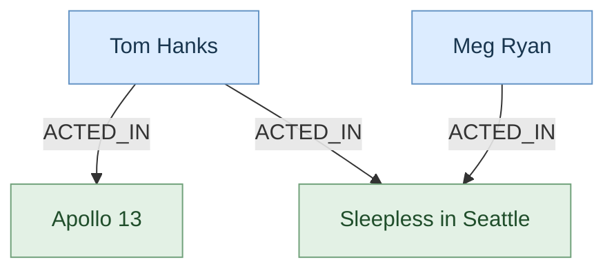

## 1. SQL VS NOSQL

## 2. Johdanto

### 2.1. Aiheen tausta

SQL tulee englannin sanoista *Structured Query Language* eli rakenteinen kyselykieli. Se on ohjelmointikieli, jota on käytetty laajasti relaatiotietokantojen hallintaan 1970-luvulta lähtien. Näitä tietokantoja hallitaan relaatiotietokannan hallintajärjestelmällä (RDBMS). Aluksi tietojen tallentaminen oli kallista, joten SQL-tietokantojen suunnittelussa pyrittiin erityisesti vähentämään saman tiedon tallentamista moneen kertaan.

SQL on ollut käytössä jo vuosikymmeniä, ja useimmat tietokantojen kanssa työskentelevät asiantuntijat tuntevat sen. Ajan myötä tiedon määrä ja muodot ovat kuitenkin muuttuneet. Myös tallennustila, tietokoneiden teho ja tiedon analysoinnin tarpeet ovat kehittyneet. Siksi on syntynyt uusia tietokantatekniikoita, jotka sopivat paremmin uudenlaisiin käyttötarkoituksiin. Näitä tietokantoja kutsutaan yleensä NoSQL-tietokannoiksi.

NoSQL-tietokannat alkoivat yleistyä 2000-luvun lopulla, kun tietojen tallentaminen tuli paljon halvemmaksi.

Kun tallentaminen halpeni nopeasti, sovellusten piti tallentaa ja käsitellä yhä suurempia tietomääriä. Tiedot olivat monenlaisia: rakenteisia, puolirakenteisia ja rakenteettomia. Siksi niiden rakennetta oli yhä vaikeampi määritellä etukäteen. NoSQL-tietokannat antavat kehittäjille mahdollisuuden tallentaa erittäin suuria määriä rakenteetonta tietoa ja muuttaa tietojen rakennetta joustavasti.

Vuonna 2009 kiinnostus NoSQL-tietokantoja kohtaan kasvoi selvästi. Tähän vaikuttivat myös kaksi tärkeää dokumenttitietokantaa: MongoDB ja CouchDB. 2010-luvulle tultaessa oli syntynyt erilaisia NoSQL-tietokantatyyppejä. Niiden käyttö alkoi levitä, kun yritykset alkoivat hyödyntää tietoa yhä enemmän.


### 2.2. Aiheen merkitys
Tietokannan valinta tai sopivan tietokannan suositteleminen on tärkeä tehtävä monille tietokanta-alan asiantuntijoille. SQL:n ja NoSQL:n vertailu auttaa tekemään perusteltuja valintoja. Valinnassa pitää ottaa huomioon tärkeimmät tietoja koskevat vaatimukset. Lisäksi on mietittävä, mistä ominaisuuksista voidaan tarvittaessa joustaa, jotta järjestelmä toimii riittävän nopeasti ja pysyy käytettävissä.

## 3. Keskeiset käsitteet

### 3.1. Peruskäsitteet

#### 3.1.1. SQL

SQL:ää käytetään edelleen paljon relaatiotietokantojen kyselyissä. Relaatiotietokannoissa tiedot tallennetaan taulukoiden riveille, ja taulukot voivat liittyä toisiinsa eri tavoin. Yksi tietue voi liittyä yhteen tai useaan muuhun tietueeseen. Myös yhden taulukon monet tietueet voivat liittyä toisen taulukon moniin tietueisiin. Relaatiotietokannat voivat tallentaa ja hakea tietoja nopeasti sekä käsitellä suuria tietomääriä ja monimutkaisia SQL-kyselyitä.

#### 3.1.2. NoSQL

NoSQL tarkoittaa ei-relationaalisia tietokantoja. Niissä tietoja voidaan tallentaa myös muilla tavoilla kuin SQL-tietokantojen riveistä ja sarakkeista koostuviin taulukoihin. Siksi tietojen rakenteeksi voidaan valita juuri niille sopiva muoto.

Kun puhutaan NoSQL-tietokannasta, tarkoitetaan yleensä mitä tahansa ei-relationaalista tietokantaa. NoSQL voidaan selittää sanoilla *non-SQL* (ei SQL) tai *not only SQL* (ei pelkästään SQL). Molemmat nimet viittaavat siihen, että tietoja voidaan tallentaa joustavasti ja niiden luonteeseen sopivalla tavalla. NoSQL tarkoittaa erilaisten tietokantojen lähestymistapaa, kun taas SQL on kyselykieli. Myös NoSQL-järjestelmillä on omia kyselykieliään.

**NoSQL-tietokantojen päätyypit**

NoSQL-tietokannoista on kehittynyt neljä päätyyppiä: dokumenttitietokannat, avain–arvo-tietokannat, laajasarakkeiset tietokannat ja graafitietokannat. Lisäksi monimalliset tietokannat ovat nykyään yhä suositumpia.

**Dokumenttitietokanta (Document database)** tallentaa tiedot dokumentteihin, jotka muistuttavat JSON-objekteja (*JavaScript Object Notation*). Jokaisessa dokumentissa on kenttiä ja niihin liittyviä arvoja. Arvot voivat olla esimerkiksi tekstiä, numeroita, totuusarvoja, listoja tai toisia objekteja. Dokumenttitietokannan tietomalli on joustava, ja se sopii hyvin puolirakenteiselle sekä usein myös rakenteettomalle tiedolle. Dokumentin sisällä voi olla myös sisäkkäisiä rakenteita. Niiden avulla voidaan kuvata monimutkaisia suhteita ja hierarkioita.

**Avain–arvo-tietokanta (Key-value database)** on yksinkertaisempi tietokantatyyppi. Jokaisella tallennetulla tiedolla on avain ja siihen liittyvä arvo. Jokainen avain on yksilöllinen. Tällaisia tietokantoja käytetään esimerkiksi välimuistissa ja käyttäjäistuntojen hallinnassa. Tietojen lukeminen ja kirjoittaminen on usein nopeaa, koska tietoja voidaan säilyttää keskusmuistissa.

**Laajasarakkeinen tietokanta (Wide-column database)** järjestää tiedot taulukoihin, riveihin ja muuttuviin sarakkeisiin. Toisin kuin perinteisissä SQL-tietokannoissa, eri riveillä voi olla eri sarakkeita. Tällainen tietokanta voi myös pakata sarakkeiden tietoja, jotta tallennustilaa kuluu vähemmän ja toiminta nopeutuu. Malli sopii harvalle tiedolle eli tilanteisiin, joissa monista kohdista puuttuu arvo.

**Graafitietokanta (Graph database)** tallentaa tiedot solmuina ja niiden välisinä yhteyksinä. Solmut voivat kuvata esimerkiksi ihmisiä, paikkoja tai esineitä. Yhteydet kertovat, miten solmut liittyvät toisiinsa. Graafitietokanta sopii hyvin tietoihin, joissa on paljon erilaisia yhteyksiä ja joissa yhteydet eivät aina ole heti selviä.

**Monimallinen tietokanta (Multi-model database)** tukee useampaa kuin yhtä NoSQL-tietomallia. Siksi kehittäjät voivat käyttää eri rakenteita sovelluksen tarpeiden mukaan. Samalla tietokannan hallintajärjestelmällä voidaan käsitellä useita tietomalleja yhdessä tietokannassa.

#### 3.1.3. ACID, CAP, BASE

##### 3.1.3.1. ACID

SQL:ää käyttävissä relaatiotietokannan hallintajärjestelmissä (RDBMS) transaktioiden luotettavuutta kuvataan usein neljällä ACID-ominaisuudella. Se, mitä ominaisuuksia järjestelmä tukee ja millaisia takuita se antaa, riippuu tietokannasta ja sen asetuksista.

- **Atomisuus (Atomicity):** transaktio joko suoritetaan kokonaan tai se epäonnistuu kokonaan. Se ei saa jäädä puoliksi valmiiksi edes järjestelmävirheen takia.
- **Eheys (Consistency):** tietokannan pitää noudattaa tietojen oikeellisuutta koskevia sääntöjä ja estää tietojen rikkoutuminen.
- **Eristävyys (Isolation):** samaan aikaan suoritettavat transaktiot erotetaan toisistaan valitun eristystason mukaisesti.
- **Pysyvyys (Durability):** onnistuneen transaktion muutokset säilyvät, vaikka järjestelmään tulisi häiriö.

##### 3.1.3.2. CAP

ACID kuvaa transaktioiden luotettavuutta. CAP-teoreema puolestaan koskee hajautettuja järjestelmiä, ja sitä voidaan soveltaa sekä relaatio- että NoSQL-tietokantoihin. Myös jotkin NoSQL-järjestelmät, esimerkiksi MongoDB, tukevat ACID-transaktioita.

CAP-teoreema kuvaa tasapainoa tietojen yhdenmukaisuuden, saatavuuden ja verkkoyhteyden katkeamisen sietämisen välillä. Jos hajautetun järjestelmän solmujen välinen yhteys katkeaa, järjestelmä ei voi samalla taata kaikille pyynnöille sekä tiukkaa yhdenmukaisuutta että saatavuutta.

- **Yhdenmukaisuus (Consistency):** jokainen pyyntö saa joko uusimman tiedon tai virheilmoituksen. Tämä tarkoittaa eri asiaa kuin ACID-mallin consistency.
- **Saatavuus (Availability):** jokainen pyyntö saa vastauksen, joka ei ole virheilmoitus.
- **Verkon jakautumisen sieto (Partition tolerance):** järjestelmä jatkaa toimintaansa, vaikka sen solmujen välinen yhteys katkeaisi. Osa pyynnöistä voi silti jäädä käsittelemättä.

##### 3.1.3.3. BASE

Joissakin NoSQL-järjestelmissä käytetään BASE-mallia. Nimi tulee sanoista *Basically Available, Soft State, Eventual Consistency* (perussaatavuus, joustava tila ja lopulta saavutettava yhdenmukaisuus). BASE ei kuitenkaan kuulu kaikkiin NoSQL-tietokantoihin.

Perussaatavuus tarkoittaa, että järjestelmä pystyy toimimaan myös osittaisten häiriöiden aikana, esimerkiksi yhden solmun vikaantuessa. Joustava tila tarkoittaa, että tiedoissa voi olla väliaikaisia eroja, kunnes tiedot muuttuvat ajan myötä jälleen yhdenmukaisiksi.

### 3.2. Käsitteiden väliset yhteydet

**Käsitteiden ja periaatteiden vertailu**

Relaatiotietokantojen ja ei-relationaalisten tietokantojen välillä on monia eroja. Yksi tärkeimmistä eroista liittyy tietojen mallintamiseen. Seuraavassa taulukossa verrataan niiden keskeisiä ominaisuuksia.

| Ominaisuus | SQL (RDBMS) | NoSQL |
|---|---|---|
| **Tietomalli (Data modeling)** | Tiedot tallennetaan taulukoihin, joissa on rivejä ja sarakkeita. Sopii hyvin rakenteiselle tiedolle. | Malli riippuu tietokannan tyypistä: avain–arvo, dokumentti, graafi tai laajasarakkeinen malli. Sopii puolirakenteiselle ja rakenteettomalle tiedolle. |
| **Tietojen rakenne (Schema)** | Rakenne on ennalta määritelty: sarakkeiden tietotyypit on päätetty etukäteen. Rakenteen muuttaminen jälkikäteen voi olla vaikeampaa. | Rakenne on joustava. Dokumenteissa, riveissä tai avain–arvo-pareissa voi olla erilaisia tietoja, ja rakennetta on usein helpompi muuttaa. |
| **Kyselykieli (Query language)** | Käytetään SQL-kyselykieltä. | Kyselykieli riippuu järjestelmästä. Esimerkiksi MongoDB käyttää MQL:ää ja Neo4j Cypheriä. |
| **Skaalautuvuus (Scalability)** | Perinteisesti käytetään usein vertikaalista skaalausta, mutta monet järjestelmät tukevat myös horisontaalista skaalausta. | Monet NoSQL-järjestelmät on suunniteltu horisontaaliseen skaalaukseen. Tarkat mahdollisuudet riippuvat järjestelmän rakenteesta. |
| **Tietojen väliset suhteet (Data relationships)** | Suhteet määritellään viiteavaimilla (*foreign keys*), ja tiedot voidaan yhdistää JOIN-kyselyillä. | Suhteet voivat olla sisäkkäisiä, suoraan määriteltyjä tai epäsuoria. |
| **Transaktiot (Transaction type)** | Yleensä käytetään ACID-transaktioita. | Osa järjestelmistä tukee ACID-transaktioita, ja osassa käytetään BASE-malliin liittyviä yhdenmukaisuuden ratkaisuja. |
| **Suorituskyky (Performance)** | Sopii monimutkaisiin kyselyihin ja transaktioita sisältäviin tehtäviin. | Voi toimia tehokkaasti tietyissä tiedonhakutavoissa ja hajautetuissa järjestelmissä. Nopeus riippuu järjestelmästä ja kyselyistä. |
| **Tietojen yhdenmukaisuus (Data consistency)** | Tietojen yhdenmukaisuus on yleensä vahva. | Monissa järjestelmissä käytetään lopulta saavutettavaa yhdenmukaisuutta (*eventual consistency*). |


## 4. Aiheen kuvaus

### 4.1. Tarkoitus ja toimintaperiaatteet

#### 4.1.1. Miten SQL toimii

SQL-tietokantoja voidaan yleensä skaalata vertikaalisesti. Tämä tarkoittaa, että järjestelmän kapasiteettia kasvatetaan käyttämällä tehokkaampaa palvelinta, jossa on esimerkiksi enemmän suoritintehoa, keskusmuistia tai SSD-tallennustilaa. Vertikaalinen skaalaus on perinteisesti yleistä, mutta SQL-tietokantoja voidaan skaalata myös horisontaalisesti. Silloin tietoja jaetaan esimerkiksi useaan osaan (*sharding*).

SQL-tietokannan rakenne perustuu relaatiomalliin. Tiedot järjestetään taulukoihin, joissa on sarakkeita eli attribuutteja ja rivejä eli tietueita. Koska tietokannan rakenne määritellään yleensä etukäteen, tiedot pitää suunnitella ja järjestää ennen tietokannan käyttöönottoa.

#### 4.1.2. Miten NoSQL toimii

NoSQL-järjestelmissä tietoja voidaan tallentaa erilaisiin rakenteisiin. Koska rakenne voi olla joustava ja muuttuva, kaikkea ei tarvitse suunnitella tarkasti etukäteen. Muutosten tekeminen on siksi usein helpompaa. NoSQL-tietokantoihin voidaan lisätä uusia kenttiä ja ominaisuuksia. Eri järjestelmillä on myös erilaisia kyselykieliä ja komentoja.

Monet NoSQL-tietokannat on suunniteltu horisontaalista skaalausta varten. Kun kuormitus kasvaa, järjestelmään voidaan lisätä uusia palvelimia tai solmuja, jos tietokannan rakenne tukee sitä.

### 4.2. Menetelmät ja käytännöt

Yksi tietokanta ei yleensä sovi yhtä hyvin kaikkiin tiedon käyttötapoihin. Monissa suurissa järjestelmissä käytetään lähestymistapaa nimeltä *polyglot persistence*. Se tarkoittaa, että samassa järjestelmässä voidaan käyttää useita erilaisia tietojen tallennusmalleja.

#### 4.2.1. Miten tallennusmalli valitaan

1. Selvitetään, miten tietoja käytetään: haetaanko yksittäisiä tietueita, lasketaanko yhteenvetoja, etsitäänkö sanoja tekstistä, samankaltaisia kohteita, tietyn aikavälin tietoja tai kokonaisia objekteja.
2. Valitaan näihin käyttötapoihin sopivat tallennusmallit.
3. Tehdään lyhyt lista palveluista, jotka tukevat valittuja malleja.
4. Verrataan vaihtoehtoja tietojen yhdenmukaisuuden, viiveen, skaalautuvuuden, ylläpidon ja kustannusten perusteella.
5. Yhdistetään eri malleja vain silloin, kun tietojen käyttötavat tai elinkaaret eroavat selvästi toisistaan.

#### 4.2.2. Tietomallin valintaperusteet

| Tarve | Sopiva tietomalli |
|---|---|
| Tiukat transaktiovaatimukset, jotka koskevat useita tietueita tai kohteita | Relaatiomalli |
| Monimutkaiset objektit, joiden rakenne muuttuu, sekä JSON-pohjainen API | Dokumenttimalli |
| Tiedon nopea haku avaimella tai välimuistin käyttö | Avain–arvo-malli |
| Suuret, harvat telemetriatiedot, joita kirjoitetaan paljon | Sarakeperheet tai aikasarjat |
| Monimutkaisten ja monitasoisten yhteyksien tutkiminen | Graafimalli |

### 4.3. Käyttökohteet

#### 4.3.1. Milloin SQL kannattaa valita

SQL on hyvä valinta, kun tiedot liittyvät vahvasti toisiinsa. Relaatiotietokannat ovat tehokkaita ja joustavia, ja niitä voidaan käyttää monenlaisissa sovelluksissa. Yksi niiden eduista on, että ne auttavat säilyttämään tietojen eheyden myös päivitysten aikana. Jos tietokannasta on useita kopioita eli replikoita, muutosten siirtymisnopeus niiden välillä riippuu järjestelmän asetuksista.

#### 4.3.2. Milloin NoSQL kannattaa valita

Suurten rakenteettomien tietomäärien tallentamiseen voivat sopia dokumenttitietokannat, kuten CouchDB, MongoDB ja Amazon DocumentDB. Jos tarvitaan nopea avain–arvo-tietokanta ilman tiukkoja eheyden takuita, Redis voi olla sopiva vaihtoehto. Jos suurista tietomääristä pitää tehdä monipuolisia hakuja, Elasticsearch voi olla hyvä ratkaisu.

Myös esimerkiksi Facebookin kehittämä Cassandra pystyy käsittelemään erittäin suuria tietomääriä, jotka on jaettu monelle palvelimelle. Se voi poistaa yksittäisen vikaantumispisteen ja parantaa järjestelmän saatavuutta.

NoSQL-järjestelmiä käytetään lähes kaikilla aloilla. Niitä käytetään esimerkiksi reaaliaikaisessa analytiikassa, sisällönhallinnassa, esineiden internetin (IoT) sovelluksissa, suosittelujärjestelmissä, petosten tunnistamisessa ja tuotekatalogien hallinnassa.

SQL on hyvä valinta, kun tiedot liittyvät vahvasti toisiinsa. Relaatiotietokannat ovat tehokkaita ja joustavia, ja niitä voidaan käyttää monenlaisissa sovelluksissa. Yksi niiden eduista on, että ne auttavat säilyttämään tietojen eheyden myös päivitysten aikana. Jos tietokannasta on useita kopioita eli replikoita, muutosten siirtymisnopeus niiden välillä riippuu järjestelmän asetuksista.

### 4.4. Hyödyt ja mahdollisuudet

#### 4.4.1. Relaatiotietokantojen edut

Relaatiotietokantojen etuja ovat esimerkiksi useita rivejä koskevien transaktioiden yhdenmukaisuus, monimutkaiset taulukoiden yhdistämiset, luotettavat säännöt tietojen välisten suhteiden eheydelle sekä kehittyneet työkalut raportointiin, ylläpitoon ja tietojen hallintaan.

SQL-tietokannoilla on pitkä historia. Siksi niillä on suuret käyttäjäyhteisöt, ja internetistä löytyy paljon esimerkkejä toimivasta ja vakaasta ohjelmakoodista.

#### 4.4.2. Eri NoSQL-mallien edut

NoSQL-järjestelmästä riippuen mahdollisia etuja ovat:

- Hajautettu tietojenkäsittely.
- Hyvä skaalautuvuus.
- Joustavat tietorakenteet ja monipuoliset kyselykielet.
- Helppokäyttöisyys kehittäjille.
- Verkkoyhteyden katkeamisen sietäminen.
- Korkea saatavuus.
- Joissakin järjestelmissä BASE-periaatteiden käyttö.


### 4.5. Haasteet, riskit ja rajoitukset

#### 4.5.1. Tietomallien rajoitukset

On tärkeää huomioida, että horisontaalinen skaalaus vaatii usein tietojen jakamista osiin (*sharding*). Relaatiotietokantojen normalisointi taas voi tehdä taulukoiden yhdistämisestä raskaampaa, jos samoja tietoja luetaan usein. Joskus tiedot olisi helpompi hakea denormalisoidusta rakenteesta, jossa niitä ei ole jaettu niin moneen taulukkoon.

Ei-relationaaliset eli NoSQL-tietokannat on usein suunniteltu joustavia tietorakenteita, horisontaalista skaalausta sekä tiettyjä haku- ja käsittelytapoja varten. Joustavuuden ja skaalautuvuuden vuoksi niissä voidaan käyttää väljempiä sääntöjä kuin relaatiotietokannoissa. Tämä voi koskea esimerkiksi tietojen rakennetta tai transaktioiden laajuutta.

**Dokumenttimalli (Document)**

Dokumentit voivat kasvaa suuriksi. Joissakin järjestelmissä transaktioilla on rajoituksia. Lisäksi tietojen rakenne pitää suunnitella huolellisesti, jos kyselyitä tehdään paljon.

**Sarakeperheet (Column-family)**

Rivien avaimet ja sarakeperheet pitää suunnitella etukäteen. Toissijaisten indeksien tuki vaihtelee, ja kyselyiden tekeminen voi olla vähemmän joustavaa kuin relaatiomallissa.

**Avain–arvo-malli (Key-value)**

Kyselymahdollisuudet ovat rajalliset. Jos tietoa halutaan hakea arvon perusteella, tietomallia voidaan joutua muuttamaan. Suurten arvojen kirjoittaminen uudelleen voi myös olla raskasta.

**Graafimalli (Graph)**

Yksinkertaisten suhteiden käsittelyyn voi kulua turhaan resursseja. Malli vaatii huolellista suunnittelua, eikä suurten tietomäärien laaja analysointi ole aina helppoa.

#### 4.5.2. Useiden teknologioiden yhdistämisen ongelmat

Järjestelmää ei kannata jakaa liian aikaisin moniin eri tietokantoihin:

- Käytä yhtä palvelua niin kauan kuin se täyttää suorituskyvyn, skaalautuvuuden ja hallinnan vaatimukset.
- Pidä tietojen luokittelun yhteiset säännöt yhdessä paikassa. Vältä myös turhaa tietojen muuntamista ja saman työn tekemistä useissa tietokannoissa.

Seuraavia yleisiä ongelmia kannattaa välttää:

- Useat mikropalvelut käyttävät samaa yhteistä tietokantaa, jolloin ne tulevat liian riippuvaisiksi toisistaan.
- Tiimi ottaa käyttöön uuden tallennusmallin, vaikka ylläpitokäytännöt, esimerkiksi valvonta ja varmuuskopiointi, eivät ole vielä riittävän hyviä.
- Hakemistoa käytetään varsinaisena tietovarastona, vaikka sitä ei ole suunniteltu siihen.

#### 4.5.3. Yleisiä väärinkäsityksiä NoSQL:stä

**NoSQL-tietokannat sopivat huonosti toisiinsa liittyville tiedoille.**
NoSQL-tietokannat pystyvät tallentamaan myös tietojen välisiä suhteita. Ne vain tekevät sen eri tavalla kuin relaatiotietokannat. Monien mielestä toisiinsa liittyvien tietojen mallintaminen voi olla NoSQL:ssä jopa helpompaa, koska tietoja ei aina tarvitse jakaa useaan taulukkoon. Sen sijaan liittyvät tiedot voidaan tallentaa samaan rakenteeseen.

**NoSQL-tietokannat eivät tue ACID-transaktioita.**
Todellisuudessa jotkin NoSQL-järjestelmät, esimerkiksi MongoDB, tukevat ACID-transaktioita.

## 5. Esimerkki

### 5.1. Tilanteen kuvaus

Erilaiset tietokannat järjestävät ja tallentavat tietoa eri tavoilla. Jotta erot olisi helpompi ymmärtää, tarkastellaan viittä yksinkertaista esimerkkiä: yhtä SQL-relaatiotietokantaa ja neljää NoSQL-tietokantojen päätyyppiä.

Esimerkit näyttävät, millaisia tietoja eri malleihin on kätevää tallentaa ja miltä tietojen rakenne voi näyttää.


### 5.2. Ratkaisu tai toimintatapa
tämä on hienoa tärkeää tekstiä jota meidän pitää pitää osana meidän textiä.
    SQL pystyy hakemaan tietojaan todella nopeasti oman takenteensa ansiosta, mutta samalla tarvitsee kyseistä rakennetta toimiakseen. Tämä johtaa ongelmiin kun eri SQL mallit usein käyttävät erilaisia rakenteita, joka tekee eri työkalujen kanssa työskentelystä paljon hankalampaa. miksi minä tänne kirjoitan?
    NOSQL puolestaan pystyy toimimaan todella helposti ja lähes millä tahansa koolla ilman ongelmia, koska rajallisen rakenteen pois jättäminen jättää tilaa laajentamiselle ja vapauksille mitä aikaisempi rakenne ei olisi hyväksynyt. Tässä kuitenkin on huonojakin puolia, koska tieto voi olla niin laajaa ja ei välttämättä sisällä yhtään rakennetta tietojen järjestely, hakeminen ja etsiminen on paljon hitaampaa verrattuna SQL. mitä on meneillään?


#### 5.2.1. Relaatiotietokanta (Relational Database, SQL)

**Esimerkki: käyttäjät ja heidän harrastuksensa**

Tarkastellaan tilannetta, jossa haluamme tallentaa käyttäjän tiedot ja harrastukset. Tallennettavia tietoja ovat etunimi, sukunimi, puhelinnumero, kaupunki ja harrastusten lista.

Relaatiotietokannan hallintajärjestelmässä (RDBMS) tekisimme todennäköisesti kaksi taulukkoa: yhden käyttäjille (Users) ja toisen harrastuksille (Hobbies). Jos haluamme saada kaikki käyttäjän tiedot ja harrastukset, meidän pitää yhdistää näiden kahden taulukon tiedot.

**Käyttäjien taulukko (User table)**

| ID | first_name | last_name | cell | city |
|---|---|---|---|---|
| 1 | Leslie | Yepp | 8125552344 | Pawnee |

**Harrastusten taulukko (Hobbies table)**

| ID | user_id | hobby |
|---|---|---|
| 10 | 1 | scrapbooking |
| 11 | 1 | eating waffles |
| 12 | 1 | working |

Kenttä `user_id` yhdistää harrastukset ensimmäisen taulukon käyttäjään.

Jotta saamme käyttäjän tiedot ja harrastukset yhdessä, meidän pitää yhdistää taulukot `JOIN`-toiminnolla.

#### 5.2.2. Dokumenttitietokanta (Document Database)

**Esimerkki: käyttäjäprofiili**

NoSQL-tietokannan tietomalli riippuu siitä, minkä tyyppisen tietokannan valitsemme. Katsotaan, miten samat käyttäjän tiedot ja harrastukset voidaan tallentaa dokumenttitietokantaan, esimerkiksi MongoDB:hen.

```json
{
  "_id": 1,
  "first_name": "Leslie",
  "last_name": "Yepp",
  "cell": "8125552344",
  "city": "Pawnee",
  "hobbies": [
    "scrapbooking",
    "eating waffles",
    "working"
  ]
}
```

Kaikki käyttäjän tiedot ja harrastukset voidaan hakea yhdestä dokumentista. Taulukoita ei tarvitse yhdistää. Tässä esimerkissä toisiinsa liittyvien tietojen hakeminen voi olla helpompaa ja nopeampaa, mutta todellinen suorituskyky riippuu tietojen rakenteesta ja kyselyiden tyypistä.

#### 5.2.3. Avain–arvo-tietokanta (Key-Value Database)

**Esimerkki: polkupyörän nimen tallentaminen**

Avain–arvo-tietokannassa jokaisella yksilöllisellä avaimella on siihen liittyvä arvo.

| Avain (Key) | Arvo (Value) |
|---|---|
| `bike:1` | `Deimos` |

Redisissä tiedon voi tallentaa ja hakea yksinkertaisilla komennoilla:

```text
SET bike:1 Deimos
GET bike:1
```

Tulos:

```text
"Deimos"
```

Arvon hakemista varten täytyy tietää sen avain. Tämä malli sopii nopeaan tiedonhakuun, esimerkiksi välimuistiin tai käyttäjäistuntojen tallentamiseen.

#### 5.2.4. Laajasarakkeinen tietokanta (Wide-Column Database)

**Esimerkki: ystävät ja sosiaaliset ryhmät**

Laajasarakkeinen tietokanta tallentaa tiedot riveihin ja sarakkeisiin, mutta eri riveillä voi olla eri sarakkeita.

Voimme esimerkiksi tallentaa tiedon siitä, miten eri ihmiset tuntevat ystävänsä.

| Käyttäjä | Fred | Gabriel | Hiroshi | Seo Yoon | Jakob |
|---|---|---|---|---|---|
| Jose | book-club | work | tennis | | |
| Sofia | | | work | school | chess-club |

Tässä taulukossa:

- Jose tuntee Fredin kirjakerhosta (*book-club*).
- Jose tuntee Gabrielin työn kautta (*work*).
- Sofia tuntee Seo Yoonin koulusta (*school*).
- Sofia tuntee Jakobin shakkikerhosta (*chess-club*).

Tavallisesta relaatiotaulukosta poiketen laajasarakkeinen malli sallii sen, että eri riveillä on eri sarakkeita.

Malli sopii suuriin ja harvoihin tietoaineistoihin, joissa eri kohteilla voi olla paljon erilaisia ominaisuuksia ja monia tyhjiä kenttiä.

#### 5.2.5. Graafitietokanta (Graph Database)

**Esimerkki: näyttelijät ja elokuvat**

Graafitietokanta tallentaa tiedot solmuina (*nodes*) ja niiden välisinä yhteyksinä (*relationships*).

Esimerkiksi näyttelijät ja elokuvat voivat olla solmuja. Yhteys `ACTED_IN` kertoo, että näyttelijä on näytellyt kyseisessä elokuvassa.



Tästä näemme, että Tom Hanks on näytellyt kahdessa elokuvassa. Lisäksi Tom Hanks ja Meg Ryan ovat näytelleet samassa elokuvassa.

Tällainen malli sopii tilanteisiin, joissa halutaan tutkia kohteiden välisiä yhteyksiä. Voimme esimerkiksi etsiä tietyn näyttelijän elokuvia, hänen kanssaan työskennelleitä näyttelijöitä tai sosiaalisen verkoston käyttäjien välisiä yhteyksiä.

### 5.4. Tulokset ja havainnot
    Tämän perusteella voimme sanoa että riippuen tilanteesta SQL ja NOSQL voivat olla selkeästi pasempia kuin toinen.
    Kun haluaa selkeästi järjesteltyä ja nopeasti saatavilla olevaa tiedostojen järjestelyä, kannattaa valita SQL.Wohoo!!!
    Kun puolestaan haluaa jotai vapaamuotoista ja helposti laajenevaa, niin kannattaa valita NOSQL.

## 6. Yhteenveto ja lähteet

### 6.1. Yhteenveto
SQL:ää käytetään relaatiotietokantojen kanssa. Niissä tiedot järjestetään toisiinsa liittyviin taulukoihin. NoSQL sisältää useita tallennusmalleja: dokumenttimallin, avain–arvo-mallin, laajasarakkeisen mallin ja graafimallin. Mallit tallentavat tietoa eri tavoilla ja sopivat erilaisiin tehtäviin.

**Tärkein johtopäätös:** NoSQL ei ole yksi tietty tallennusmalli, vaan ryhmä erilaisia ratkaisuja. SQL:n ja NoSQL:n valinta riippuu tietojen rakenteesta, niiden käyttötavoista ja sovelluksen vaatimuksista.

Valinnassa pitää huomioida tietomallin helppouden lisäksi kyselyiden tyyppi, transaktioiden ja tietojen yhdenmukaisuuden vaatimukset, skaalautuvuus sekä ylläpidon kustannukset. Käytännön esimerkit osoittavat, että yhtä kaikille sopivaa ratkaisua ei ole. Joskus yksi tietokanta riittää, mutta joskus eri mallien yhdistäminen on hyödyllistä.


### 6.2. Lähteet
    https://fi.wikipedia.org/wiki/Tietokanta
    https://en.wikipedia.org/wiki/NoSQL
    https://en.wikipedia.org/wiki/SQL
    Trust me...

    
    Anderson, B. & Nicholson, B. SQL vs. NoSQL Databases: What's the Difference? IBM. Viitattu 16.11.2026.
    [https://www.ibm.com/think/topics/sql-vs-nosql](https://www.ibm.com/think/topics/sql-vs-nosql)

    Microsoft. 2025. Understand data models. Microsoft Learn, Azure Architecture Center. Viitattu 16.11.2026.
    [https://learn.microsoft.com/en-us/azure/architecture/data-guide/technology-choices/understand-data-store-models](https://learn.microsoft.com/en-us/azure/architecture/data-guide/technology-choices/understand-data-store-models)

    Schaefer, L. What Is NoSQL? NoSQL Databases Explained. MongoDB. Viitattu 16.11.2026.
    [https://www.mongodb.com/resources/basics/databases/nosql-explained](https://www.mongodb.com/resources/basics/databases/nosql-explained)

    Redis. Redis Strings. Redis Documentation. Viitattu 16.11.2026.
    [https://redis.io/docs/latest/develop/data-types/strings/](https://redis.io/docs/latest/develop/data-types/strings/)

    Google Cloud. Schema design best practices. Bigtable Documentation. Viitattu 16.11.2026.
    [https://docs.cloud.google.com/bigtable/docs/schema-design](https://docs.cloud.google.com/bigtable/docs/schema-design)

    Neo4j. Tutorial: Create a graph data model. Neo4j Documentation. Viitattu 16.11.2026.
    [https://neo4j.com/docs/getting-started/data-modeling/tutorial-data-modeling/](https://neo4j.com/docs/getting-started/data-modeling/tutorial-data-modeling/)

    MongoDB. Transactions. MongoDB Manual. Viitattu 16.11.2026.
    [https://www.mongodb.com/docs/manual/core/transactions/](https://www.mongodb.com/docs/manual/core/transactions/)

    Brewer, E. 2017. Inside Cloud Spanner and the CAP Theorem. Google Cloud Blog. Viitattu 16.11.2026.
    [https://cloud.google.com/blog/products/databases/inside-cloud-spanner-and-the-cap-theorem](https://cloud.google.com/blog/products/databases/inside-cloud-spanner-and-the-cap-theorem/)
